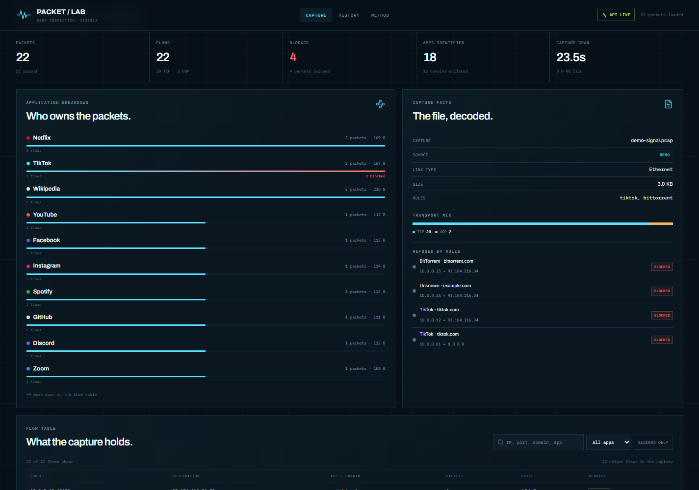

# PacketAnalyzer — Deep Packet Inspection, MERN

A live PCAP analysis lab. Upload a capture, parse Ethernet/IP/TCP/UDP, extract TLS SNI, DNS names, and HTTP Host headers, classify applications, and apply blocking rules. Every analysis is stored in MongoDB and keeps a snapshot of the rules that were active.

This is the MERN rebuild of the original C++ DPI engine. The C++ implementation is preserved in [`engine/`](engine/) for reference.

## Credits and my contribution

- Original C++ DPI engine: `perryvegehan`, preserved in `engine/` for reference.
- The MERN rebuild, PCAP parser, classifier, REST API, React lab, tests, Dockerfile, and deployment are the work presented in this repository.

## Live demo

| Surface | URL |
|---|---|
| React capture lab | https://packetanalyzer.furqankhan.dev |
| Express API | https://packet-analyzer-api-ud0m.onrender.com/api/health |

## Screenshots

| Capture lab | Analysis |
|---|---|
|  |  |

## What works

- **Classic PCAP parsing.** Little- or big-endian, microsecond or nanosecond timestamps, Ethernet with optional VLAN tags, raw IPv4, and Linux cooked captures.
- **Application identification.** TLS ClientHello SNI, DNS query names, and HTTP Host headers are matched against a classifier catalogue of 18 apps.
- **Flow aggregation.** Five-tuple flows track packets, bytes, app, domain, first/last timestamp, and blocked state.
- **Blocking rules.** Toggle blocked apps, add blocked domain substrings, and apply them to the next capture. The rule snapshot is stored with each run.
- **Real run history.** MongoDB stores summaries, flows, domains, and packet traces. Old runs keep the rules they were analyzed with.
- **Demo capture.** The API generates a valid synthetic PCAP with 22 packets across known apps, DNS queries, and an HTTP request.
- **Upload.** Classic `.pcap` files up to 8 MB are parsed in memory.

## Architecture

```
web/                 React + Vite frontend
  src/
    pages/           Capture, history, run detail, method
    components/      Upload, rules, flow table, analysis view
    useLab.js        API state and actions

api/                 Express + MongoDB API
  src/
    pcap.js          PCAP, Ethernet, IPv4, TCP/UDP, TLS SNI, DNS, HTTP
    sample.js        Synthetic demo capture generator
    analysis.js      Parse, persist, list, load, delete
    rules.js         Blocking rules
    models.js        Analysis and Rule schemas
    routes.js        REST surface

engine/              Original C++ DPI engine and sample captures
```

## API

| Method | Path | Purpose |
|---|---|---|
| `GET` | `/api/health` | Health check with MongoDB readiness |
| `GET` | `/api/openapi.json` | OpenAPI 3.1 contract |
| `GET` | `/api/apps` | Classifier catalogue |
| `GET` | `/api/rules` | Current blocking rules |
| `PUT` | `/api/rules` | Update blocked apps/domains (operator token) |
| `POST` | `/api/analyze` | Upload and parse a PCAP |
| `POST` | `/api/analyze/demo` | Parse the generated demo capture |
| `GET` | `/api/runs` | Saved analysis history |
| `GET` | `/api/runs/:id` | One full analysis |
| `DELETE` | `/api/runs/:id` | Remove a saved analysis (operator token) |

## Operator gate and API contract

Rule changes and run deletion require the `x-demo-admin-token` header. The default
demo value is `demo-operator-key`; set `ADMIN_TOKEN` on Render to override it. This
is a demo gate, not production authentication. Upload and demo endpoints are
rate-limited and parsed in memory.

The OpenAPI contract is served at `/api/openapi.json`. Each response carries an
`x-request-id`, and the API emits one structured JSON log line per request.

## Run locally

```bash
npm run install:all

# API (port 4200)
# api/.env: MONGODB_URI=...
npm run dev:api

# Web (port 5176, proxies /api to 4200)
npm run dev:web
```

## Tests

```bash
npm test
```

Seven tests cover the parser, demo capture, SNI classification, flow counts, stored history, MongoDB readiness, operator-token gating, schema validation, invalid uploads, and deletion.

## Deployment

- **Frontend:** Vercel static build, proxying `/api` to the Render API.
- **API:** Render web service from `api/`; a production-style `Dockerfile` is included.
- **Database:** MongoDB Atlas database `packetanalyzer` on `Cluster0`.
- **CI:** GitHub Actions runs API tests and the frontend build on every push.

## Honest limitations

- Classic PCAP only; pcapng is not supported.
- No TCP reassembly. A TLS ClientHello split across segments may not yield SNI.
- No IPv6, QUIC, or Encrypted ClientHello (ECH) inspection.
- Checksums are not validated; the parser trusts the capture bytes.
- The built-in demo capture is synthetic and labelled `source: demo`.
- Payloads are not stored; the database keeps flow summaries and a short packet trace.

## License

MIT. See [LICENSE](LICENSE).
