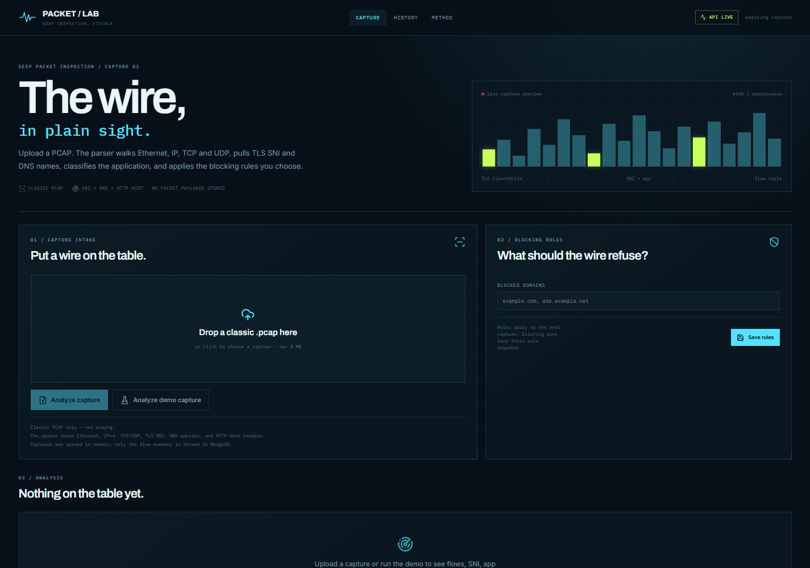

# PacketAnalyzer

> Deep packet inspection, in plain sight.

[](https://packetanalyzer.furqankhan.dev)
[](https://furqankhan.dev)
[](LICENSE)

PacketAnalyzer is a browser lab for classic PCAP captures. Upload a capture or run the synthetic demo, and it decodes the packets, identifies applications from TLS SNI, DNS query names, and HTTP Host headers, folds traffic into five-tuple flows, applies blocking rules, and stores the run with the rules that were active. It is for developers who want to see how a DPI pipeline works without a desktop analyzer or a production network tap.

Part of [Furqan Khan's portfolio](https://furqankhan.dev).

**Live:** https://packetanalyzer.furqankhan.dev · **Source:** https://github.com/fk219/packet-analyzer · **Case study:** https://furqankhan.dev

## What it is

The project has two surfaces. The React app is the instrument panel: a Capture page for uploads and the demo, a History page for saved runs, a run detail view, and a How it works page. The Express API does the actual work: PCAP decoding, application identification, flow aggregation, rule application, and MongoDB persistence. This is a MERN rebuild of an earlier C++ DPI engine; the original C++ implementation and sample captures remain in `engine/`.

Uploads are parsed in memory and capped at 8 MB by default. The database keeps the analysis summary, flows, domain counts, and a short packet trace, not the raw payloads. On first boot the API seeds the default rules and, if the analysis collection is empty, one demo run.

| Capture lab | Analysis |
|---|---|
|  |  |

## The signature idea

Deep packet inspection usually happens inside an appliance or a kernel path, where the decisions are hard to see. Here the chain is exposed at every step: read the PCAP records, decode the link and network headers, pull names out of the payload, classify the domain, aggregate packets into flows, apply the current rules, and persist the result.

The stored rule snapshot is the part that makes the lab useful. Every analysis keeps the rule set that was active when it ran: blocked apps, domain substrings, and IPs. Changing the rules later changes the next analysis, not the history, so an old run still explains the verdict it was given.

## What works

- **Classic PCAP parsing.** Little- and big-endian files, microsecond and nanosecond timestamps, Ethernet with optional VLAN tags, raw IPv4, and Linux cooked captures.
- **Application identification.** TLS ClientHello SNI, DNS query names, and HTTP Host headers are matched against an 18-app catalogue.
- **Flow aggregation.** Five-tuple flows track packets, bytes, app, domain, first/last timestamp, and blocked state.
- **Blocking rules.** Toggle blocked apps and add blocked domain substrings. The API schema also accepts blocked source IPs. Rules apply to the next capture, and the active set is stored with each run.
- **Run history.** MongoDB stores summaries, flows, domains, and packet traces. Old runs keep the rules they were analyzed with.
- **Demo capture.** The API generates a valid synthetic PCAP with 22 packets across known apps, DNS queries, and an HTTP request.
- **Upload path.** Classic `.pcap` files up to the configured limit are accepted and parsed in memory.
- **API contract.** The service publishes an OpenAPI 3.1 document, returns an `x-request-id` on every response, and writes one structured JSON log line per request.

## Tech stack in detail

| Layer | Technology | What it does here |
|---|---|---|
| Frontend | React 18, Vite 5, React Router 6 | Capture, history, run detail, and method screens |
| UI | Custom CSS, lucide-react | Lab layout, tables, controls, and icons |
| API | Express 4 | REST surface under `/api`, JSON errors, CORS, and Helmet headers |
| PCAP parser | Custom Node.js parser | Endianness, timestamps, link types, IPv4, TCP/UDP, SNI, DNS, and Host extraction |
| Classification | 18-app domain catalogue | Maps observed domains to application names |
| Flows and rules | Five-tuple aggregation and a rule engine | Packet/byte counts, blocked state, and snapshots |
| Persistence | MongoDB, Mongoose 8 | Analyses, rule documents, and history indexes |
| Validation and limits | Zod 4, express-rate-limit | Request schemas, upload cap, API/write/analyze limits, and the operator gate |
| Observability | Custom request context | Request IDs, structured JSON logs, and status-aware levels |
| Testing and delivery | Vitest, Supertest, mongodb-memory-server, Render, Vercel, GitHub Actions | Parser/API tests and the deployed split |

## Architecture

An upload reaches Express through multer's memory storage. `parsePcap` reads the capture record by record, decodes the link type, walks IPv4 and TCP/UDP headers, extracts names from payloads, classifies the domains, and builds the flow list under the current rules. `analysis.js` stores the parsed result and its rule snapshot in MongoDB. The React app reads summaries from `/api/runs` and the full flow list and trace from `/api/runs/:id`.

```text
.pcap upload / synthetic demo
            |
            v
    PCAP record reader
    endianness, timestamps, link type
            |
            v
    Ethernet + VLAN / raw IPv4 / Linux cooked
            |
            v
    IPv4 + TCP/UDP
            |
            +--> TLS SNI / DNS / HTTP Host
            |             |
            |             v
            |     18-app classifier
            v
    five-tuple flow aggregation
            |
            v
    current blocking rules
            |
            v
    analysis document + rule snapshot
            |
            v
    MongoDB --> /api/runs --> React lab
```

```text
web/                         React + Vite lab
  src/
    pages/                   Dashboard.jsx, History.jsx, RunDetail.jsx, HowItWorks.jsx
    components/              UploadPanel, RulesPanel, FlowTable, AnalysisView
    useLab.js                API state and actions
    api.js                   Fetch wrapper with retries and the demo operator header

api/                         Express + MongoDB API
  src/
    pcap.js                  PCAP, Ethernet/VLAN, IPv4, TCP/UDP, SNI, DNS, HTTP
    sample.js                Synthetic 22-packet demo capture
    analysis.js              Parse, persist, list, load, delete
    rules.js                 Blocking rules
    models.js                Analysis and Rule schemas
    routes.js                REST surface
    app.js                   Middleware, CORS, errors
    security.js              Rate limits and operator gate
    openapi.js               OpenAPI 3.1 contract
  test/                      Parser and API tests

engine/                      Original C++ DPI engine and sample captures
docs/                        Screenshots
```

## Run it locally

Prerequisites: Node 20 or 22 and npm, plus a MongoDB instance or an Atlas connection string. CI and the `Dockerfile` use Node 20; `.nvmrc` and the Render config use Node 22.

```bash
npm run install:all

# Create api/.env from api/.env.example, then review the connection settings.

# API on http://localhost:4200
npm run dev:api

# Web on http://localhost:5176, proxying /api to port 4200
npm run dev:web
```

Create `api/.env` from `api/.env.example`. The web app reads its optional settings from `web/.env`; without `VITE_API_URL`, Vite proxies `/api` to the local API.

| Name | Required | Purpose |
|---|---|---|
| `MONGODB_URI` | No | MongoDB connection string. Development falls back to a local database; set this to Atlas in production. |
| `PORT` | No | API port. Defaults to `4200`. |
| `CORS_ORIGIN` | No | Comma-separated allowed origins. An empty value allows all origins. |
| `MAX_UPLOAD_BYTES` | No | Upload cap in bytes. Defaults to 8 MB. |
| `ADMIN_TOKEN` | No | Overrides the demo token used for rule changes and run deletion; set it in production. |
| `NODE_ENV` | No | Runtime mode used by the server. |
| `VITE_API_URL` | No | Web API base URL. Empty uses the Vite proxy or same-origin `/api`. |
| `VITE_DEMO_ADMIN_TOKEN` | No | Token the web app sends for writes. It must match `ADMIN_TOKEN`. |

**Demo access:** there is no login. Open the Capture page and press **Analyze demo capture**, or open the History page for a saved run. Rule changes and deletion use the demo operator gate, not a user account.

## API

| Method | Path | Purpose |
|---|---|---|
| `GET` | `/api/health` | Health check with MongoDB readiness |
| `GET` | `/api/openapi.json` | OpenAPI 3.1 contract |
| `GET` | `/api/apps` | Classifier catalogue |
| `GET` | `/api/rules` | Current blocking rules and the app catalogue |
| `PUT` | `/api/rules` | Update blocking rules (operator token) |
| `POST` | `/api/analyze` | Upload and parse a PCAP as `multipart/form-data` |
| `POST` | `/api/analyze/demo` | Parse the generated demo capture |
| `GET` | `/api/runs` | Saved analysis history |
| `GET` | `/api/runs/:id` | One full analysis with flows and trace |
| `DELETE` | `/api/runs/:id` | Remove a saved analysis (operator token) |

The operator gate uses the `x-demo-admin-token` header. It is a demo control, not production authentication. The API also rate-limits the general API, upload/demo analysis, and write endpoints.

## Tests

```bash
npm test
```

The root command runs the API suite through Vitest: five API tests and two parser tests. Together they cover the parser, demo capture, SNI classification, flow counts, stored history, MongoDB readiness, operator-token gating, schema validation, invalid uploads, and deletion. API tests use `mongodb-memory-server`, so they do not need a local MongoDB.

## Deployment

- **Frontend:** Vercel serves the Vite build from `web/`. `web/vercel.json` rewrites `/api/*` to the Render API and falls back to `index.html` for client-side routes.
- **API:** Render deploys the `api/` service from `render.yaml` on Node 22, region Singapore, free plan. The health check is `/api/health`, the build is `npm install --omit=dev`, and the start command is `npm start`. The deployed health endpoint is https://packet-analyzer-api-ud0m.onrender.com/api/health.
- **Database:** MongoDB Atlas in the live deployment. Set `MONGODB_URI` and `CORS_ORIGIN` in Render; `MAX_UPLOAD_BYTES` is fixed at 8 MB in the blueprint.
- **Container:** `api/Dockerfile` is a Node 20 Alpine image that exposes port 4200 and runs `node src/index.js`.
- **CI:** GitHub Actions runs API tests and the web build on pushes to `main` or `master` and on pull requests, using Node 20.

## Limits and notes

- Classic PCAP only. pcapng is not supported; convert with `editcap -F pcap` first.
- No TCP reassembly. A TLS ClientHello split across segments may not produce SNI.
- No IPv6, QUIC, or Encrypted ClientHello (ECH) inspection.
- Checksums are not validated; the parser trusts the capture bytes.
- The built-in demo capture is synthetic and labelled `source: demo`.
- Payloads are not stored. The database keeps flow summaries and a short packet trace.
- The operator gate is a demo control, not an authentication system.
- The free Render API can cold-start after inactivity, so the first request may be slow.
- Uploads are capped and parsed in memory; this is a lab, not a packet sensor.

## Credits and my contribution

- Original C++ DPI engine: `perryvegehan`, preserved in `engine/` for reference.
- The MERN rebuild, PCAP parser, classifier, REST API, React lab, tests, Dockerfile, and deployment are the work presented in this repository.

## License

MIT. See [LICENSE](LICENSE).
